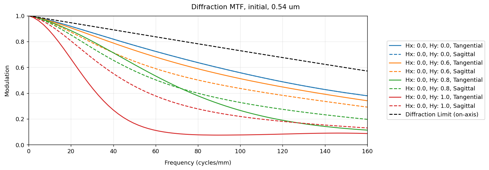

In this blog post, I will share a tutorial on the lens optimization with Optiland toolbox [optiland](https://github.com/tqv-notes/optiland) (forked from [original](https://github.com/optiland/optiland)). This toolbox is an open source for designing and simulating optical systems. The commercial alternatives are Zemax and Code V.

For direct comparison with commercial optical software alternatives (here is Zemax), I will use input data from this [blog](https://www.opticalensdesign.com/post/lens-design-process-with-zemax-optimization-part-1). The 7mmF4_110deg_11ELT_01.zmx file can be downloaded from that blog post (need Zemax software to decrypt it) or via this [link](https://github.com/tqv-notes/optiland/blob/master/demo/input/zemax_files/7mmF4_110deg_11ELT_01.zmx).

{:height="40%" width="80%" style="display:block; margin-left:auto; margin-right:auto;"}

{:height="40%" width="80%" style="display:block; margin-left:auto; margin-right:auto;"}

{:height="40%" width="80%" style="display:block; margin-left:auto; margin-right:auto;"}

{:height="40%" width="80%" style="display:block; margin-left:auto; margin-right:auto;"}

{:height="40%" width="80%" style="display:block; margin-left:auto; margin-right:auto;"}

{:height="40%" width="80%" style="display:block; margin-left:auto; margin-right:auto;"}

