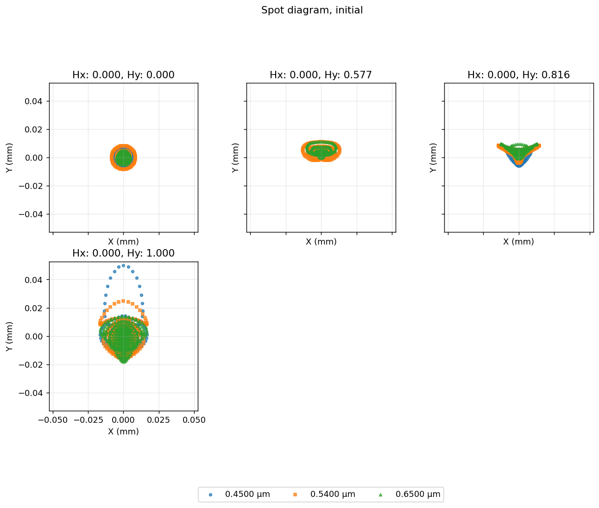
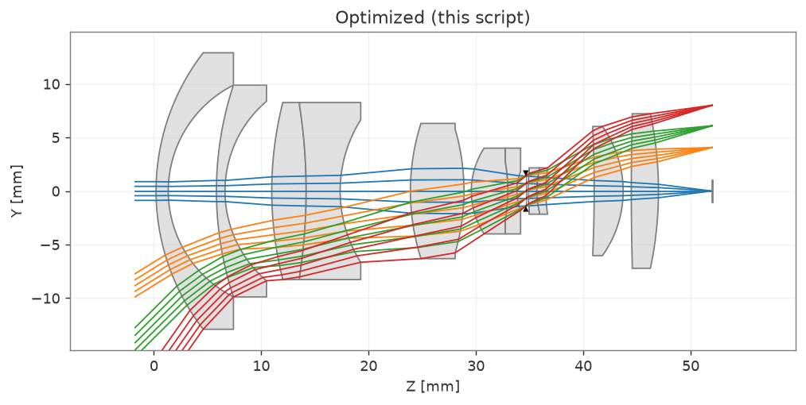
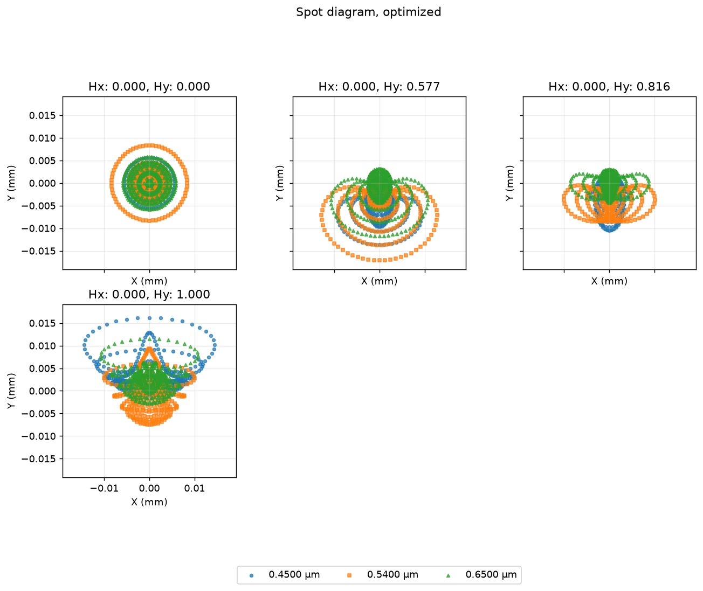

In this blog post, I will share a tutorial on the lens optimization with Optiland toolbox [optiland](https://github.com/tqv-notes/optiland) (forked from [original](https://github.com/optiland/optiland)). This toolbox is an open source for designing and simulating optical systems. The commercial alternatives are Zemax and Code V.

For direct comparison with commercial optical software alternatives (here is Zemax), I will use input data from this [blog](https://www.opticalensdesign.com/post/lens-design-process-with-zemax-optimization-part-1). The 7mmF4_110deg_11ELT_01.zmx file can be downloaded from that blog post (need Zemax software to decrypt it) or via this [link](https://github.com/tqv-notes/optiland/blob/master/demo/input/zemax_files/7mmF4_110deg_11ELT_01.zmx). The full script for this tutorial is provided [here](https://github.com/tqv-notes/optiland/blob/master/demo/optimization_tutorial.py).

In this tutorial, the input file is used as the starting point of the optimization. 

To visualize the optical layout from this file, we can use this script: 

```python
lens = load_lens(START_FILE)
print(
    f"loaded {START_FILE.name}: {lens.surfaces.num_surfaces - 2} surfaces, "
    f"F/{float(be.to_numpy(lens.paraxial.FNO())):g}, "
    f"fields {[round(f.y, 2) for f in lens.fields]} deg"
)
start = print_summary(lens, "starting point")
fig, _ = lens.draw(num_rays=5, figsize=(10, 4), title="Starting point (_01)")
```

{:height="40%" width="80%" style="display:block; margin-left:auto; margin-right:auto;"}

and the spot diagram and MTF (modulation transfer function) can be obtained via this script:
```python
spot = SpotDiagram(lens, num_rings=12)
fig, _ = spot.view(show=False)
fig.suptitle("Spot diagram, initial", y=1.04)
save(fig, "1_spot_initial")

wavelength = lens.primary_wavelength

mtf = FFTMTF(
    lens, wavelength=wavelength, num_rays=128, grid_size=512, max_freq=160
)
fig, _ = mtf.view(add_reference=True)
fig.suptitle(f"Diffraction MTF, initial, {wavelength} um", y=1.02)
save(fig, "1_mtf_initial")

save_optiland_file(lens, str(OUT / "7mmF4_initial.json"))
save_zemax_file(lens, str(OUT / "7mmF4_initial.zmx"))
print(f"  saved the lens as {OUT / '7mmF4_initial.json'} and .zmx")
```

{:height="40%" width="80%" style="display:block; margin-left:auto; margin-right:auto;"}

{:height="40%" width="80%" style="display:block; margin-left:auto; margin-right:auto;"}

The spot diagram information is summarized in this table:

     field  RMS spot [um]  MTF T @145  MTF S @145
      0.00           3.72       0.415       0.415
     31.75           4.79       0.378       0.325
     44.91           5.27       0.133       0.223
     55.00          10.05       0.090       0.147

The lens design optimization is done using the so-called 'Glass Expert' algorithm which searches for better-performing glasses by exploring nearest neighbors in the material space, followed by continuous local refinement of lens parameter.

```python
class DLSGlassExpert(optimization.GlassExpert):
    """GlassExpert that uses damped least squares for each local optimization.

    The glass search is still performed by GlassExpert; only the inner
    optimizer is replaced with Optiland's damped least-squares method.
    """

    evals = 150

    def optimize(self, **_: Any) -> Any:
        """Run one damped least-squares optimization of the current glasses."""
        try:
            return optimization.minimize(
                self.problem, "dls", maxiter=self.evals, aim_policy="frozen"
            )
        except (ValueError, RuntimeError) as exc:
            # A candidate glass may prevent the rays from passing through.
            print(f"(failed: {exc}) ", end="")
            return SimpleNamespace(
                fun=float("inf"),
                x=[v.value for v in self.problem.variables],
            )


if not SKIP_GLASS_SUBSTITUTION:
    section("4. Glass substitution (Hammer)")

    # Exclude precision-moulding glasses and variant suffixes.
    glasses = [
        g for g in glasses_selection(0.45, 0.65, catalogs=["cdgm"])
        if not (g.startswith("D-") or g.endswith(("-25", "GT")))
    ]
    glass_surfaces = [s for s in range(2, image) if is_glass(lens, s)]

    for surface in glass_surfaces:
        problem.add_variable(
            lens, "material", surface_number=surface, glass_selection=glasses
        )

    print(
        f"{len(glass_surfaces)} glasses may change, among {len(glasses)} CDGM "
        f"glasses; {NEIGHBOURS} candidates per glass and pass, "
        f"{HAMMER_EVALS} merit evaluations each"
    )
    t0 = time.perf_counter()
    hammer = DLSGlassExpert(problem)
    hammer.evals = HAMMER_EVALS
    hammer.run(num_neighbours=NEIGHBOURS, verbose=True)

    # Finish with a full local optimization after the glass search.
    optimization.minimize(problem, "dls", maxiter=LOCAL_EVALS,
                          aim_policy="frozen")
    print(f"glass substitution: {(time.perf_counter() - t0) / 60:.1f} min")
    print("glasses:", ", ".join(
        f"{s}: {lens.surfaces[s].material_post.name}" for s in glass_surfaces
    ))
else:
    print("Glass substitution skipped (SKIP_GLASS_SUBSTITUTION=True).")

```

Here is the cross-section of the final design of this optimization:

{:height="40%" width="80%" style="display:block; margin-left:auto; margin-right:auto;"}

and the spot diagram and MTF of this optimized optical system are shown here:

{:height="40%" width="80%" style="display:block; margin-left:auto; margin-right:auto;"}

{:height="40%" width="80%" style="display:block; margin-left:auto; margin-right:auto;"}

The spot diagram information for the final lens is shown as follows:

     field  RMS spot [um]  MTF T @145  MTF S @145
      0.00           1.34       0.586       0.586
     31.75           2.03       0.420       0.408
     44.91           2.53       0.368       0.413
     55.00           3.49       0.279       0.378

From this table, we can see that we can be seen from the spot diagram the lens resolution has increased significantly: the on-axis RMS spot radius started off at 3.72 um and is now 1.34 um and the spot radius for the corner field also improved from 10.05 um to 3.49 um.
