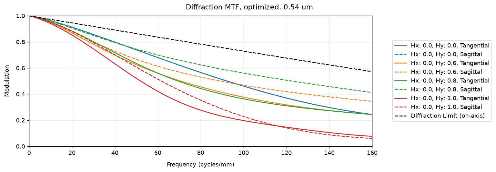

In this blog post, I will share a tutorial on the lens optimization with Optiland toolbox [optiland](https://github.com/tqv-notes/optiland) (forked from [original](https://github.com/optiland/optiland)). This toolbox is an open source for designing and simulating optical systems. The commercial alternatives are Zemax and Code V.

For direct comparison with commercial optical software alternatives (here is Zemax), I will use input data from this [blog](https://www.opticalensdesign.com/post/lens-design-process-with-zemax-optimization-part-1). The 7mmF4_110deg_11ELT_01.zmx file can be downloaded from that blog post (need Zemax software to decrypt it) or via this [link](https://github.com/tqv-notes/optiland/blob/master/demo/input/zemax_files/7mmF4_110deg_11ELT_01.zmx). The full script for this tutorial is provided [here](https://github.com/tqv-notes/optiland/blob/master/demo/optimization_tutorial.py).

In this tutorial, the input file is used as the starting point of the optimization. 

To visualize the optical layout from this file, we can use this script: 

```python
lens = load_lens(START_FILE)
print(
    f"loaded {START_FILE.name}: {lens.surfaces.num_surfaces - 2} surfaces, "
    f"F/{float(be.to_numpy(lens.paraxial.FNO())):g}, "
    f"fields {[round(f.y, 2) for f in lens.fields]} deg"
)
start = print_summary(lens, "starting point")
fig, _ = lens.draw(num_rays=5, figsize=(10, 4), title="Starting point (_01)")
```

{:height="40%" width="80%" style="display:block; margin-left:auto; margin-right:auto;"}

and the spot diagram and MTF (modulation transfer function) can be obtained via this script:
```python
spot = SpotDiagram(lens, num_rings=12)
fig, _ = spot.view(show=False)
fig.suptitle("Spot diagram, initial", y=1.04)
save(fig, "1_spot_initial")

wavelength = lens.primary_wavelength

mtf = FFTMTF(
    lens, wavelength=wavelength, num_rays=128, grid_size=512, max_freq=160
)
fig, _ = mtf.view(add_reference=True)
fig.suptitle(f"Diffraction MTF, initial, {wavelength} um", y=1.02)
save(fig, "1_mtf_initial")

save_optiland_file(lens, str(OUT / "7mmF4_initial.json"))
save_zemax_file(lens, str(OUT / "7mmF4_initial.zmx"))
print(f"  saved the lens as {OUT / '7mmF4_initial.json'} and .zmx")
```

{:height="40%" width="80%" style="display:block; margin-left:auto; margin-right:auto;"}

{:height="40%" width="80%" style="display:block; margin-left:auto; margin-right:auto;"}

{:height="40%" width="80%" style="display:block; margin-left:auto; margin-right:auto;"}

{:height="40%" width="80%" style="display:block; margin-left:auto; margin-right:auto;"}

{:height="40%" width="80%" style="display:block; margin-left:auto; margin-right:auto;"}


